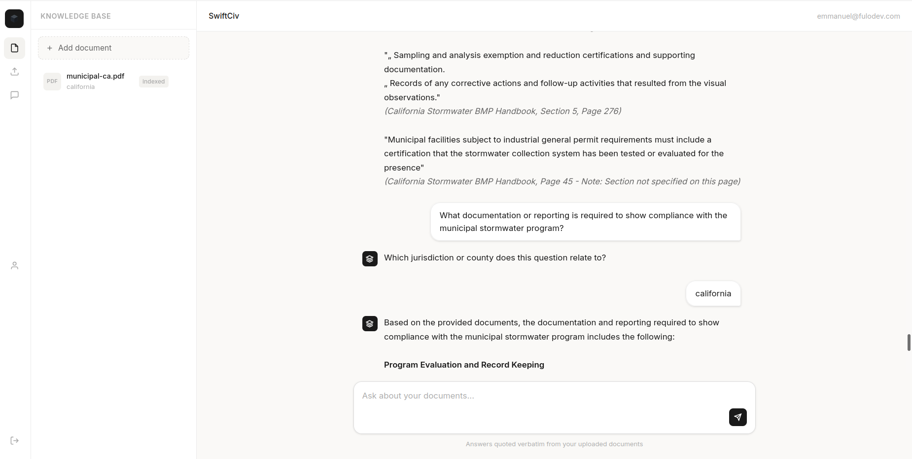

# SwiftCiv

A RAG SaaS for civil engineers. Upload county manuals and design standards, ask regulatory questions in plain English, and get verbatim quotes with section and page citations.

Previously Ragion. Live at [swiftciv.com](https://swiftciv.com).

[Blog / design document](https://osasufyi.notion.site/SwiftCiv-Design-Document-33548366ce84800da6d1fda999774757)

---



## Table of Contents

- [Overview](#overview)
- [The problem](#the-problem)
- [Features](#features)
- [How it works](#how-it-works)
- [Tech stack](#tech-stack)
- [Getting started](#getting-started)
- [Demo](#demo)
- [Roadmap](#roadmap)

---

## Overview

**SwiftCiv** is a production RAG application for civil engineers. Users upload PDFs (county manuals, stormwater standards, land development codes), ask questions in plain English, and receive answers that quote the source document verbatim with section number and page citation.

Jurisdiction is detected from the document. Quotes and page citations are enforced in the system prompt. Documents are private and persist across sessions.

---

## The problem

Engineers already try to use ChatGPT for code lookups. Making it reliable takes prompt engineering, maintenance, and it still forgets rules between sessions.

SwiftCiv does this out of the box:

- Jurisdiction detected from the document — no prompting
- Verbatim quotes enforced — the model cannot paraphrase
- Page citations always included
- Upload once, query forever
- Works correctly from the first question

---

## Features

- Magic-link auth after Stripe checkout (£97/month) — no password
- PDF upload with real-time indexing progress
- Automatic jurisdiction detection from the first pages of the document
- Conversational search with verbatim quotes and page citations
- Source-backed answers from the user's private document set
- Chat history with cursor-based pagination
- Document status pills: processing, indexed, deleting
- Account page: plan, billing date, cancel / reactivate / update card
- Feedback via Telegram

---

## How it works

1. User signs up via Stripe and logs in with a magic link (AWS SES).
2. They upload a PDF. SwiftCiv hashes it (reject duplicates), stores it on Hetzner S3, and queues indexing.
3. A Celery worker chunks the document (1200 chars, 600 overlap), embeds it, and writes vectors to a private Pinecone namespace with deterministic IDs.
4. Jurisdiction is inferred from the first three pages via Gemini.
5. On a question, the app retrieves `k=15` chunks and the LLM returns a quoted answer with section and page.
6. Messages are saved idempotently using the Celery `task_id`.

Deletion spans PostgreSQL, Pinecone, and S3. Failures retry with backoff; stuck jobs are requeued and alerted on Telegram.

---

## Tech stack

- **Frontend:** HTML, CSS, JavaScript, Jinja2
- **Backend:** Flask, Gunicorn, Caddy
- **Auth:** magic links (`itsdangerous`), AWS SES
- **Payments:** Stripe (checkout, webhooks, billing portal)
- **Database:** PostgreSQL (SQLAlchemy)
- **Search / RAG:** Pinecone, LangChain, Google Gemini
- **Storage:** Hetzner S3
- **Queue / progress:** Celery, Redis
- **Deploy:** Hetzner VPS (Ubuntu 24), Docker / Disco, Let's Encrypt via Caddy
- **Alerts:** Telegram

---

## Getting started

```Bash
git clone <https://github.com/emmanueluwa/ragion.git>
cd <repo>
pip install -r requirements.txt
```

Copy .env.example to .env and fill in keys (Gemini, Pinecone, Stripe, SES, Redis, Postgres, S3).

```Bash
python app.py
```

In another terminal:

```Bash
celery -A tasks worker --loglevel=info
```

Upload a PDF and ask a regulatory question.

# Demo

## Roadmap

Inline PDF viewer on citation click
Chat history search
Team accounts and shared knowledge bases
Multi-document / multi-county compare
Managed Postgres + backups
GitHub Actions CI/CD
